We're excited to announce Bublik v2.20.0! <br />
This release adds an **iteration matrix**, lets you **classify results** across
several runs from History and the Multiple runs page, and introduces **access
tokens** for agents and scripts. The **Runs charts** are redesigned, the
sidebar gets a **project switcher**, and filters take values and expressions in
**one field**.

### What's New

**Iteration Matrix** <br />
Lay a test's iterations out by their parameters and spot failing combinations
at a glance.

**Classify From History and Multiple Runs** <br />
Pick results from several runs and classify them under one issue in one go.

**Access Tokens** <br />
Let an MCP client, a CI job or a script call Bublik as you.

**Redesigned Runs Charts** <br />
Group by day, week or month, and click a bar to list its runs.

**Project Switcher** <br />
A searchable project list at the top of the sidebar that remembers your pick.

**Values and Expressions in One Field** <br />
Filter runs and history by values and expressions in the same field.

<!--truncate-->

## Highlights

### Iteration Matrix

Open a test's iterations on the run page and click **Matrix** to see them as a
grid of parameters, so failure patterns stand out.

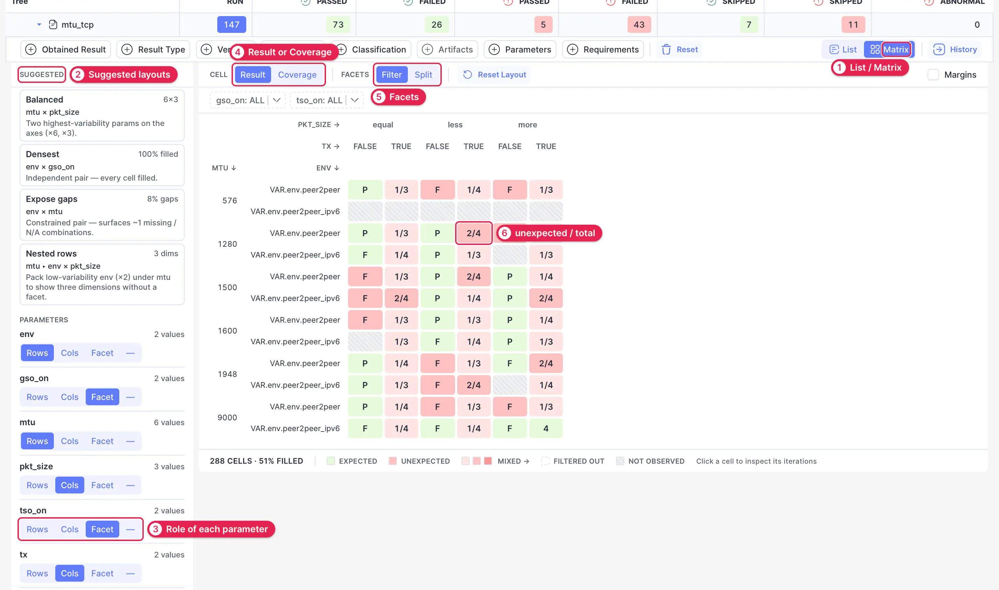

1. **List / Matrix.** Filters apply to both views, and the layout is kept in
   the URL.
2. **Suggested** layouts: **Balanced**, **Densest**, **Expose gaps** and
   **Nested rows**.
3. **Parameters.** Put each one on **Rows**, **Cols**, **Facet** or leave it
   out. Two parameters on one axis are nested.
4. **Cell** colours by **Result** or by **Coverage**.
5. **Facets.** **Filter** shows one facet value at a time, **Split** draws a
   matrix per value. **Margins** adds totals.
6. **Cells** show **P**, **F** or **S**, an iteration count, or unexpected out
   of total, such as `2/4`. Hatched cells never ran, dashed ones are filtered
   out.

Click a cell to open its iterations:

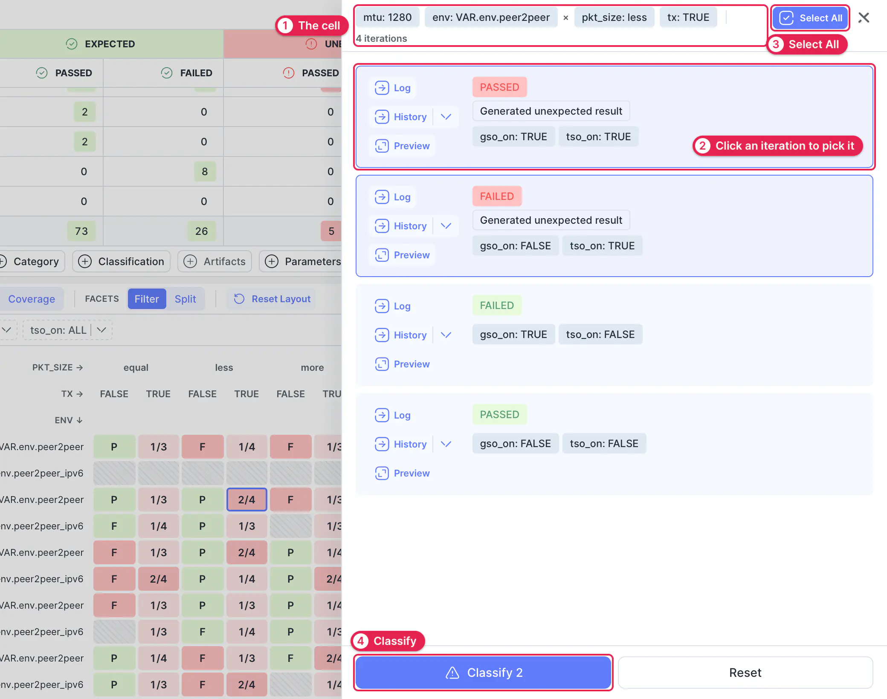

1. The cell's parameter values.
2. **Click an iteration** to pick it. Picks from several cells and from the
   list join one selection.
3. **Select All** picks every failed or classified iteration of the cell.
4. **Classify** opens the classify form.

### Classify From History and Multiple Runs

Classification is no longer limited to the run page. One selection can now
hold results of several runs, picked on the **Multiple runs** page, in
**History** or in the **iteration matrix**. Only failed or already classified
results of one project can be picked.

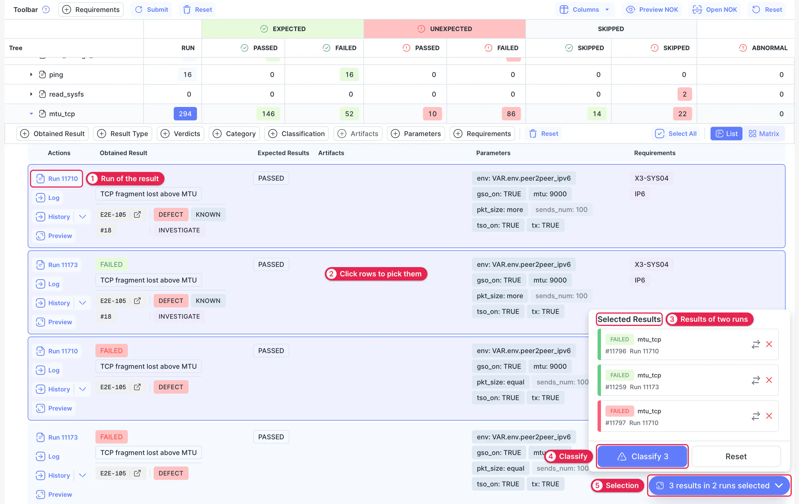

1. Each result names its **run**.
2. **Click rows** to pick them, or use **Select All**.
3. **Selected Results** lists the picks with their runs.
4. **Classify** opens the form for all of them.
5. The **selection pill** shows how many results and runs are picked.

When the results come from several runs, **Match scope** in the form shows the
rules it will write:

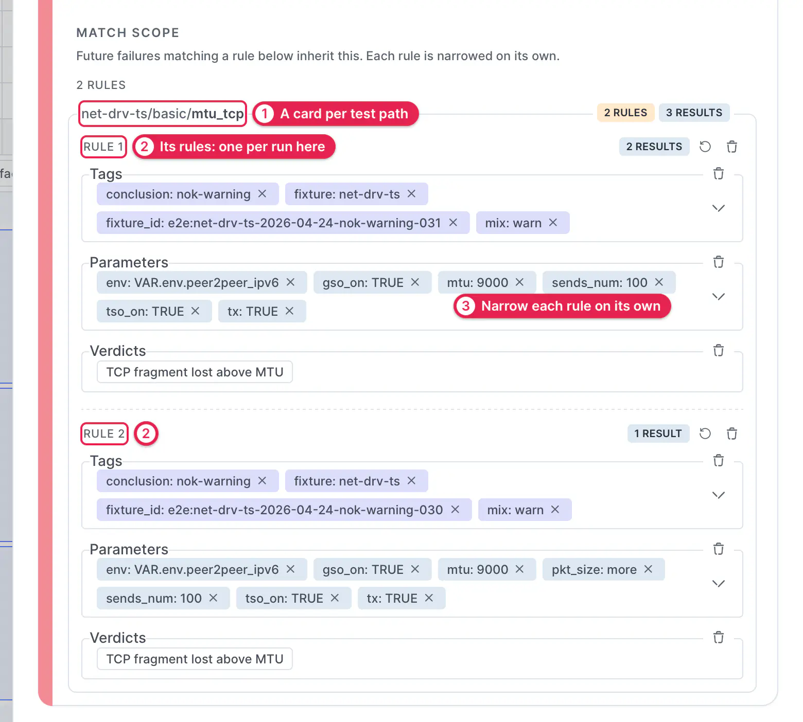

1. **A card per test path.**
2. **A rule per group of runs** with the same important tags.
3. **Narrow each rule on its own.** Remove values to match more widely.

The selection is classified all at once: every result, or none.

In History, click a row in **List Of Results**, or a whole group in **Groups
Of Results**:

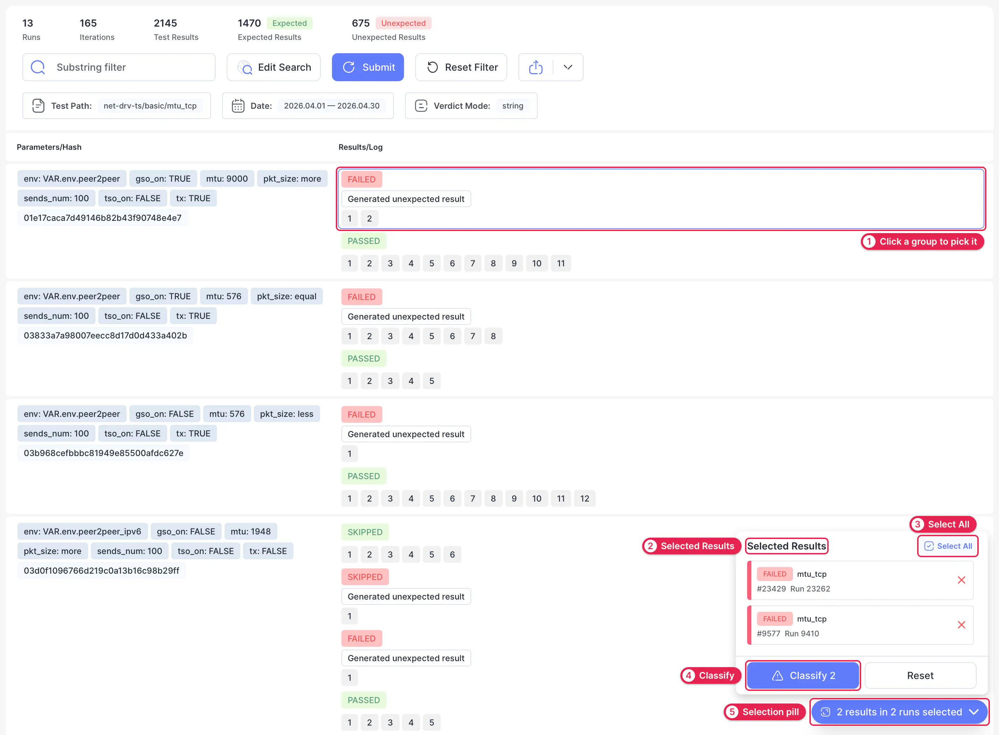

1. **Click a group** to pick all of its results.
2. **Selected Results** lists the picks.
3. **Select All** picks every result on the page.
4. **Classify** files them under one issue.
5. The **selection pill** shows the count.

Picks survive filter, page and view changes. Classified rows show the
**SUPPRESSED** or **STALE** chip, as on the run page.

### Access Tokens

A personal access token lets an AI agent through the
[MCP server](/configuration/mcp), a CI job or a script call Bublik with your
permissions. Open **Settings → Access Tokens** from the account menu.

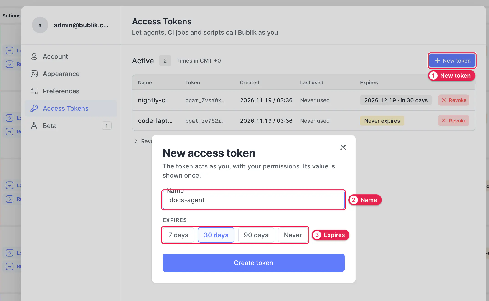

1. **New token.**
2. **Name** it after where it's used, such as `nightly-ci`.
3. **Expires** in 7, 30 or 90 days, or **Never**.

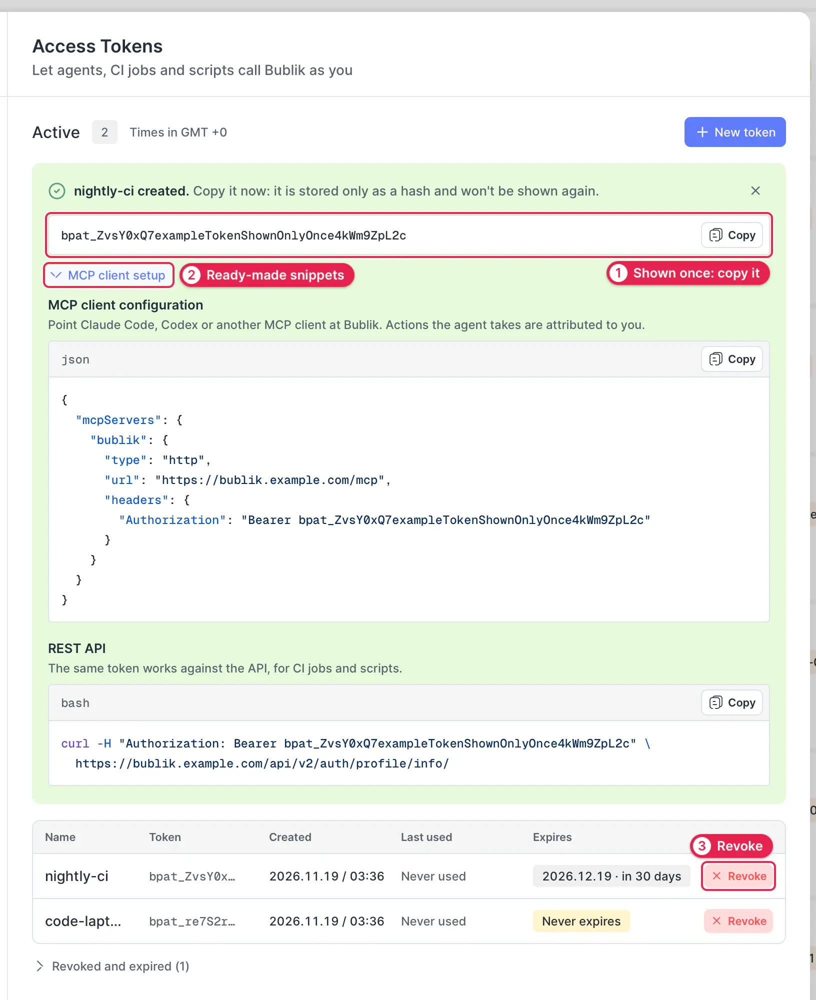

1. **Copy token.** It's shown **only once**.
2. **MCP client setup** gives ready-to-copy MCP config and `curl` snippets.
3. **Active** tokens with their last use and expiry. **Revoke** takes effect
   on the next request.

Admins can see and revoke every user's tokens under **Admin → Access Tokens**:

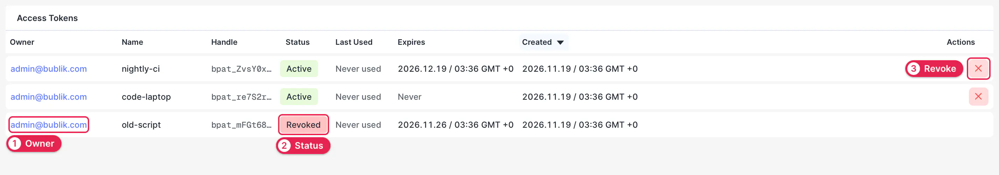

1. **Owner.**
2. **Status**: Active, Expired or Revoked.
3. **Revoke.**

Good to know:

- MCP clients without a token still work anonymously. A bad, expired or
  revoked token gets a `401`.
- Tokens can't manage tokens or users.
- Up to 20 active tokens, and 10 new ones per hour.
- Deactivating a user revokes their tokens for good.
- On a headless server:
  `python manage.py issue_user_token <email> --name <name> --expires 30`
  (`7`, `30`, `90` or `never`).

### Redesigned Runs Charts

**Runs → Charts** now shows runs and test results over time.

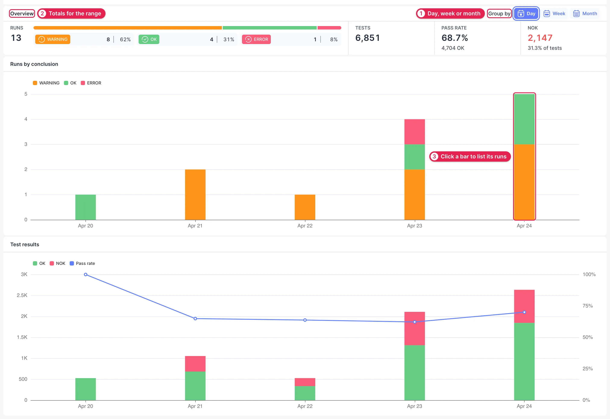

1. **Group by** Day, Week or Month.
2. **Overview**: runs by conclusion, tests, pass rate and NOK results.
3. **Click a bar** to list its runs in a drawer.

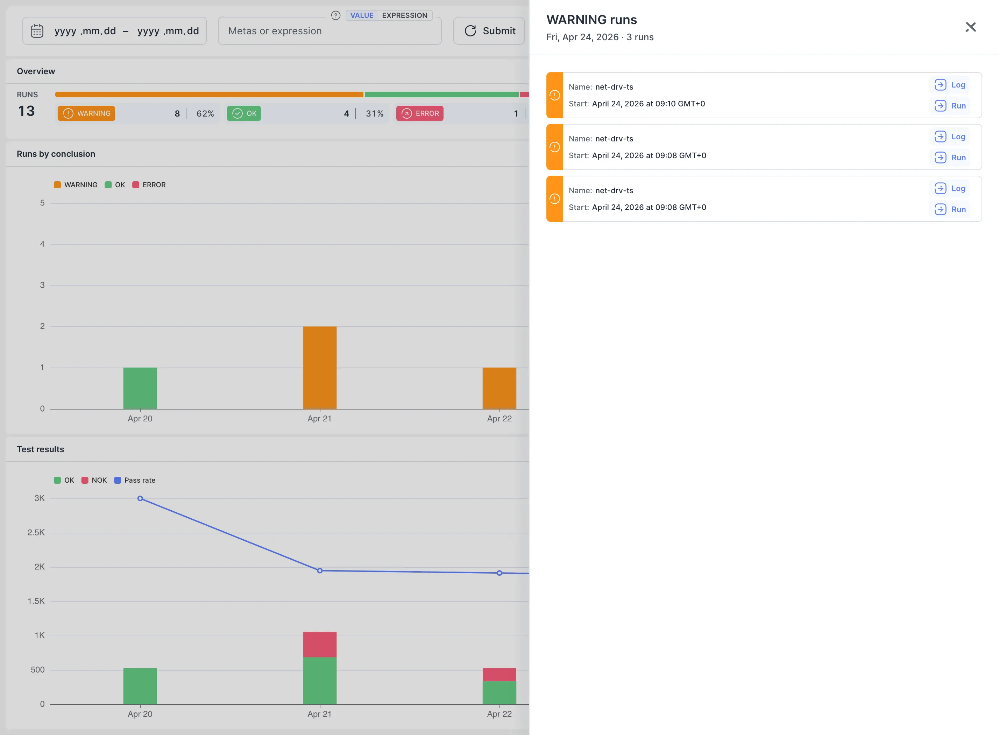

The two charts zoom and hover together.

### Project Switcher

The project picker is now a searchable list at the top of the sidebar.

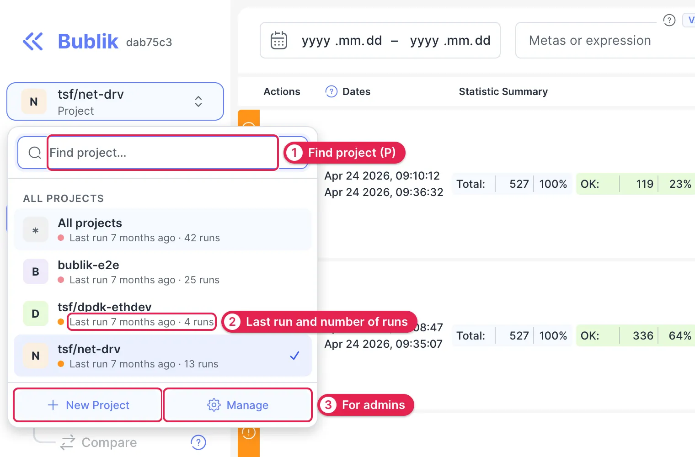

1. **Find project**, or press `P` anywhere.
2. Each project's last run and run count.
3. **New Project** and **Manage** for admins.

New tabs open with the last project you picked. Links with a project open as
before.

### Values and Expressions in One Field

Runs metas and the History filters (tags, labels, branches, revisions,
parameters) no longer split values and expressions into two fields.

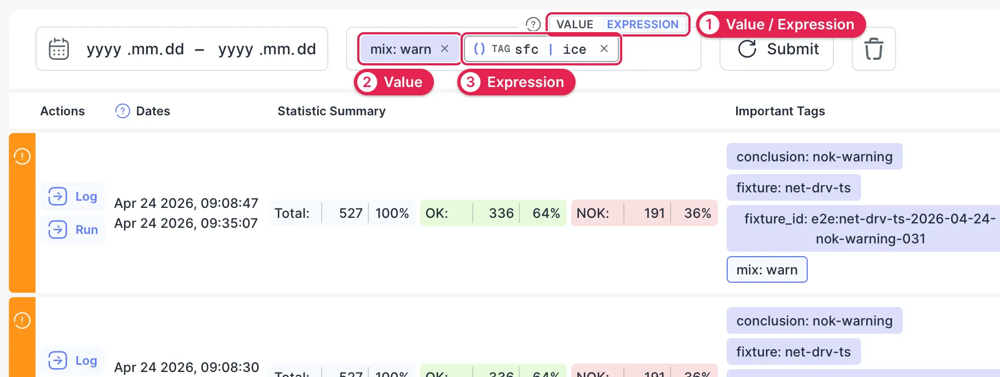

1. **Value / Expression.** Typing `&`, `|`, `!`, `(` or `)` switches to an
   expression.
2. A **value chip**, such as `mix: warn`.
3. An **expression chip**, such as `sfc | ice`. Click a chip to edit it.

Old links open with the same filters.

### Import Tasks

- **Revoke** unfinished imports in **Admin → Import**. They get the
  **REVOKED** status and **Try Again**. A run revoked mid-import may miss
  post-processing such as categorization.
- **Copy Log** copies time, level and module, not just messages.
- XML log imports now match `rgt-bublik-json`: correct dates in every
  timezone, no more cut or split values with line breaks, `&` or colons, and
  logs without an execution plan import again.
- Line graphs with sequence numbers on the X axis are saved. Force import older
  runs to get them.
- Force import keeps the **compromised** mark, and a failed one no longer drops
  the run's logs link.
- A lost database connection is retried after 1, 2 and 4 minutes. An import
  interrupted three times fails instead of running forever.
- Live import keeps the keys, notes and tag expressions of results, and
  accepts `null` values.
- The import log no longer shows raw internal errors when a failure email
  can't be sent.
- On bare metal, the Celery worker restarts after a failure.

### Links From Run Metadata

Labels holding URLs, such as a pull request, can now show as short links
(`#94`, a 7-character hash) in the run's Info block and on the dashboard.
Assign the label to a category in the project's `meta` config:

```json
"Docker PR": {
  "type": "label",
  "set-patterns": ["^DOCKER_PR$"]
}
```

Then add the category to `SPECIAL_CATEGORIES` in `per_conf`, or add a
`go_url` column to `DASHBOARD_COLUMNS`:

```json
{
  "key": "Docker PR",
  "label": "Docker PR",
  "payload": "go_url"
}
```

Existing runs pick it up when the config is saved.

### Open Tabs Move to the New Version

Tabs left open during an update no longer end up at "Something went wrong".
They check for a new version every five minutes and load it on the next page
you open. Bare-metal installs need the new nginx config, see
[Backend Update](#backend-update).

### Help Opens the User Guide

The `?` buttons open the matching section of the new **User Guide** in these
docs, replacing the old help dialogs.

### Smaller Improvements

- **Page layout.** On screens wider than 1920px, choose **Full width**, **Left
  sidebar** or **Centered** in **Settings → Appearance → Layout**.

  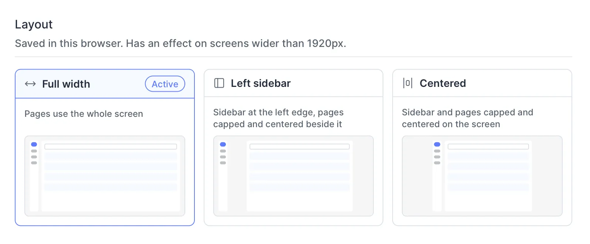
- **Log layouts.** **Settings → Preferences** sets the layout log links open
  in:

  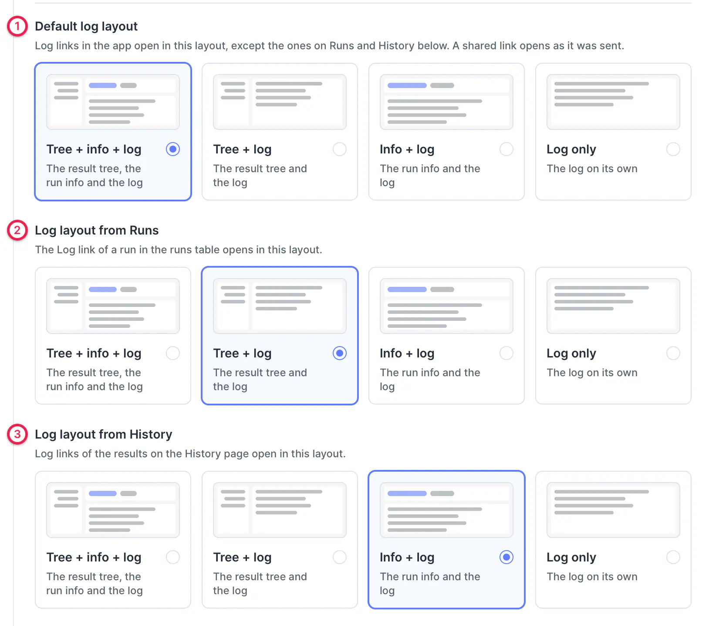

  1. **Default log layout**: Tree + info + log.
  2. **Log layout from Runs**: Tree + log.
  3. **Log layout from History**: Info + log.

  The defaults match the old behaviour.

- **Run and issue pages.** Issues, Log, Reports, Results and Rules links moved
  from the page headers to the sidebar.
- **Run table.** Totals sit next to the columns they sum, and counts are
  right-aligned.
- **Rules.** Edit and Duplicate show the saved values, Duplicate keeps the
  disposition, and a new **Match only failures without any verdict** option.
- **Permissions.** Each project's own config read setting now applies, even
  when the global settings allow anonymous reads.
- **MCP.** New `search_docs`, `get_doc` and `list_docs` tools, and an
  in-memory response cache per server.
- **Fixes.** Old `/log/<run>/<id>` links keep their layout, `/chat` says when
  chat is off, History no longer serves another query's cache, and docs pages
  with a dot in their name no longer 404.

## Admin Section

### Backend Update

1. `cd bublik`
2. `git remote update`
3. `git checkout v2.20.0`
4. `./scripts/deploy --steps django_settings celery_service nginx_conf migrate_db run_side_servers run_services`

:::warning
The `nginx_conf` and `run_side_servers` steps require root rights. They
install the new nginx configuration: files of the UI build are served with a
long cache lifetime and a missing one is a `404`, while `index.html` is
checked for changes on every request. Open tabs rely on it to
[move to the new version](#open-tabs-move-to-the-new-version). If nginx is
configured by hand on your host, apply the changes of
`templates/nginx.bublik.template` to your configuration.
:::

### Frontend Update

1. Trigger the workflow in your frontend repository
2. Synchronize the mirrors
3. `cd bublik-ui`
4. `git remote update`
5. `git checkout v2.20.0`

### Documentation Update

1. Trigger the workflow in your frontend repository
2. Synchronize the mirrors
3. `cd bublik-docs`
4. `git remote update`
5. `git checkout v2.20.0`

### Docker Instance Update

```bash
# 1. Backup the current db
task backup:create

# 2. Update the image tag in the .env file
sed -i "s/^IMAGE_TAG=.*/IMAGE_TAG=2.20.0/" .env

# 3. Pull the latest docker image
task pull

# 4. Start the docker container
task up
```

## Changelog

### Frontend

#### 🚀 New Feature

* **admin:** draw the users table like the issues table ([38400ea](https://github.com/ts-factory/bublik-ui/commit/38400ea67244109e315da0c558efefc781386dff))
* **admin:** list and revoke every user's access token ([98d3925](https://github.com/ts-factory/bublik-ui/commit/98d39250733954c4fec86b31ddeea958fdaa6728))
* **api:** add the access token endpoints ([07414dc](https://github.com/ts-factory/bublik-ui/commit/07414dc1bf990651cea97a9f65549b4578fd2de8))
* **app:** open the next page in a newly deployed build ([78c2cef](https://github.com/ts-factory/bublik-ui/commit/78c2cef9fa726871299cd8de5ce270f0a6ce11e1))
* **app:** reload when a chunk is gone after a new build ([02785e6](https://github.com/ts-factory/bublik-ui/commit/02785e6a19522decd015f82f46184d7ce97ae309))
* **build:** emit version.json with a build id ([e16478c](https://github.com/ts-factory/bublik-ui/commit/e16478c1b5d7dd8ad6afac6b2a7204414fa71946))
* **classification:** classify a selection that spans runs ([34f0e1b](https://github.com/ts-factory/bublik-ui/commit/34f0e1b6599dae65fe19278892adb061fc36f891))
* **classification:** edit each rule of the classify form on its own ([bcaf2c9](https://github.com/ts-factory/bublik-ui/commit/bcaf2c98fff065676e46decb03888b721773faea))
* **classification:** give each rule the form's own inputs ([f695866](https://github.com/ts-factory/bublik-ui/commit/f695866aec9a0b481bb30663cd46b234fb7a52ab))
* **classification:** group the classify form's rules by test path ([0d85e2d](https://github.com/ts-factory/bublik-ui/commit/0d85e2d91539ea343a5dff0a96ca661ae4d04d31))
* **classification:** keep only the runs' shared tags in one step ([b8ce58a](https://github.com/ts-factory/bublik-ui/commit/b8ce58a1dfb79f109db57629a55790229af317fe))
* **classification:** keep the classify form of one run's results as it was ([313d1a9](https://github.com/ts-factory/bublik-ui/commit/313d1a92ac0896256a9c9fd464e56a26bb68f435))
* **classification:** leave issue page navigation to the sidebar ([42976bf](https://github.com/ts-factory/bublik-ui/commit/42976bfec57119b1031db91eb96f586f524e3a87))
* **classification:** offer Select All in the selection popover ([8b2dfdc](https://github.com/ts-factory/bublik-ui/commit/8b2dfdcd68c84c8b22d8d2019a7be951152e8f0e))
* **classification:** show the verdict chip without a Classify button ([291462f](https://github.com/ts-factory/bublik-ui/commit/291462fb447db8d29aa06c49444918e1a778fbdb))
* **classification:** write rules as specific as the classified results ([f203345](https://github.com/ts-factory/bublik-ui/commit/f20334503b8dd0c407151a8d78bfcf94fafe868c))
* **history:** pick linear rows to classify them ([7b996cc](https://github.com/ts-factory/bublik-ui/commit/7b996cccd83deea35237f9e3b0a3cccd8cfe62dd))
* **history:** pick verdict groups to classify them ([a775563](https://github.com/ts-factory/bublik-ui/commit/a775563d77380d300579933b9d6fdb5a8348915d))
* **history:** select all listed linear rows from the popover ([f368501](https://github.com/ts-factory/bublik-ui/commit/f3685017fa3d2a6149fbfe30222da540c2b2fab4))
* **history:** show the classification chip on linear rows ([bd052ea](https://github.com/ts-factory/bublik-ui/commit/bd052ea8759ab416a0c6f2a7cc008db48cfe64b6))
* **history:** take values and expressions in one field per filter ([76bb630](https://github.com/ts-factory/bublik-ui/commit/76bb6308836c44f8822f7422e58bdff04ef84578))
* **import:** revoke unfinished import tasks ([45b0b5e](https://github.com/ts-factory/bublik-ui/commit/45b0b5eaf2e31b792a9aba06c99755f749587840))
* **import:** show revoked import tasks ([117e467](https://github.com/ts-factory/bublik-ui/commit/117e46772f837f209716089c2076fd7a65a19298))
* **layout:** let the page width be capped in a left or centered layout ([294d3e8](https://github.com/ts-factory/bublik-ui/commit/294d3e888df9f430e0e871d211c8e15eb1fe2998))
* **log:** add a default log layout preference for in-app log links ([ad26084](https://github.com/ts-factory/bublik-ui/commit/ad260843d97d52301c1f1ebc925959c777f64bdf))
* **log:** give Runs and History their own default log layouts ([d540964](https://github.com/ts-factory/bublik-ui/commit/d540964321cbde7b86ae057746c963f3ec4c5941))
* **projects:** add New Project and Manage to the switcher ([ebd0e34](https://github.com/ts-factory/bublik-ui/commit/ebd0e34f089c3fd68644a8eb84f13b284e932ac8))
* **projects:** switch projects from a searchable popover ([3cf90b3](https://github.com/ts-factory/bublik-ui/commit/3cf90b3c25da5adc0a3f159ce43ad1afa991ac1b))
* **run:** add iteration matrix analysis module ([be2008e](https://github.com/ts-factory/bublik-ui/commit/be2008e694cee6e3a968e036c4b8f154f8bbfd1d))
* **run:** add iteration matrix view component ([2753ece](https://github.com/ts-factory/bublik-ui/commit/2753ecedfb6227b3e31d056924277222d40f5ff4))
* **run:** add List/Matrix view toggle to the iteration table ([b6ce7fc](https://github.com/ts-factory/bublik-ui/commit/b6ce7fc9dcc18b68dae99666191b51ae13bb7240))
* **run:** build out the iteration matrix view ([96de0be](https://github.com/ts-factory/bublik-ui/commit/96de0be8ab8eb9eef61faf37a246eefa6be012d3))
* **run:** classify matrix cell iterations through the result selection ([403b155](https://github.com/ts-factory/bublik-ui/commit/403b15544990dc616881829da047bf579da72780))
* **run:** link special category values to their URLs ([52532c9](https://github.com/ts-factory/bublik-ui/commit/52532c9b77969b32959657c34132d9fb8ce42c20))
* **run:** move the run header's links to the sidebar ([54fb005](https://github.com/ts-factory/bublik-ui/commit/54fb005935d04e35d7181e7a21cc6a63e9ecd43d))
* **run:** right-align numbers in the run table ([93c240d](https://github.com/ts-factory/bublik-ui/commit/93c240d3400a966e49a33bd47b04fb8f5639669f))
* **runs:** break the run conclusions down in the overview ([7b8e9de](https://github.com/ts-factory/bublik-ui/commit/7b8e9de692ddb37a51ed07df0807423c526ee4e5))
* **run:** select results on the multiple runs page ([3098ef9](https://github.com/ts-factory/bublik-ui/commit/3098ef9fc42b1808aabf0005afc1c93092cf7567))
* **runs:** fill the page height with the runs charts ([e25ca2f](https://github.com/ts-factory/bublik-ui/commit/e25ca2f1455dd979c4e0988ba41349463f03da22))
* **runs:** filter runs by metas and expressions in one input ([112f6b4](https://github.com/ts-factory/bublik-ui/commit/112f6b42b230dbdf23d085965e7f5c45785e83a0))
* **runs:** group the runs charts by day, week or month ([9e4fe14](https://github.com/ts-factory/bublik-ui/commit/9e4fe14c335e8fb5d60247325f11d26c7491a137))
* **runs:** hover the runs charts' timelines together ([edcf826](https://github.com/ts-factory/bublik-ui/commit/edcf8269a43d7d3869ba095f52132c81b928c698))
* **runs:** label the charts period toggle and give each period an icon ([edba6a5](https://github.com/ts-factory/bublik-ui/commit/edba6a5a8550c5a5e622912542c00d311a2e999f))
* **runs:** list a chart's runs in a drawer ([5fe0519](https://github.com/ts-factory/bublik-ui/commit/5fe05199b007bb48ac501bef836746688b9c4fa0))
* **runs:** redesign the runs charts ([ede3669](https://github.com/ts-factory/bublik-ui/commit/ede366901f88b72185cb31a07242761a657bee01))
* **runs:** zoom the runs charts' timelines together ([312357b](https://github.com/ts-factory/bublik-ui/commit/312357b52a37adce8ed67fb678341ea6db67b87b))
* **settings:** show that the account row opens a menu ([3bd2b47](https://github.com/ts-factory/bublik-ui/commit/3bd2b479fb83800d4327ac0ea8f553d766bf3332))
* **sidebar:** keep the project picker under the logo ([0b53868](https://github.com/ts-factory/bublik-ui/commit/0b53868c6042385508f0ec87062a6648a0f48f17))
* **sidebar:** open the docs from the help buttons ([0923c40](https://github.com/ts-factory/bublik-ui/commit/0923c40e73544eed49285a4b84a52e1ec5e1cf36))
* **tokens:** manage access tokens from settings ([1f566f6](https://github.com/ts-factory/bublik-ui/commit/1f566f68685f8311d9c3f5cd69a33e295783f6f1))
* **ui:** add a highlighted code block with a copy button ([cfca16e](https://github.com/ts-factory/bublik-ui/commit/cfca16e3a9d3e0a1b6cbf1428c5a2a9ff30015eb))
* **ui:** add a meta filter input for value and expression chips ([68c30c7](https://github.com/ts-factory/bublik-ui/commit/68c30c7e5afb836f03a16923b15f94fdb493a4e7))
* **ui:** add SegmentedTabs ([3777670](https://github.com/ts-factory/bublik-ui/commit/3777670b57621301cbbac28cf28b7a366ecbaf70))
* **ui:** keep faceted filters to one row in a narrow toolbar ([2cb301d](https://github.com/ts-factory/bublik-ui/commit/2cb301dc834380fe3df692bf7cc9af25675b3824))

#### 💅 Polish

* **settings:** show preference choices as cards and toggles as switches ([67511a5](https://github.com/ts-factory/bublik-ui/commit/67511a55a648165804775888664bf4cecb9bef6d))
* **ui:** set conclusion badges in upper case ([53caf4e](https://github.com/ts-factory/bublik-ui/commit/53caf4e828b3b33f84f4c7619fac1aa6b14a6862))

#### 🐛 Bug Fix

* **app:** allow one automatic page load per minute ([53f29ad](https://github.com/ts-factory/bublik-ui/commit/53f29adadc0eb9141b61a2099ec63033f41438ac))
* **charts:** apply the tooltip shadow and corner radius ([5a18f3c](https://github.com/ts-factory/bublik-ui/commit/5a18f3c990767d80adf1bf7bd3b27d4adba623f8))
* **chat:** show a disabled state on /chat when chat is off ([973f014](https://github.com/ts-factory/bublik-ui/commit/973f014eaa6a96890438ea5f12027e7912c2e2a4))
* **classification:** keep a duplicated rule's disposition ([c78ebf3](https://github.com/ts-factory/bublik-ui/commit/c78ebf320540c8ead1fb726b13ccb81dbe483330))
* **classification:** keep a rule's "no verdicts" through Edit and Duplicate ([18deeab](https://github.com/ts-factory/bublik-ui/commit/18deeab19f15504e7d2b07ab3639b3f86da869b7))
* **classification:** reset the rule form when the rule changes ([3ad3dcd](https://github.com/ts-factory/bublik-ui/commit/3ad3dcd4653156e152bddd5633f8757fcb2e05f1))
* **classification:** right-align the Results counts in the issue tables ([39d623e](https://github.com/ts-factory/bublik-ui/commit/39d623e3f10241861f98e3365d05daed19f98375))
* **history:** keep the result card's width and height steady ([626596c](https://github.com/ts-factory/bublik-ui/commit/626596cc1381a623b3b6ca115ada310dc445848d))
* **import:** copy every column of the import log ([b5a15be](https://github.com/ts-factory/bublik-ui/commit/b5a15be2a46a99572858e8b276ab79977abc0dc3))
* **log:** keep the layout of the legacy /log/:id/:old link ([e48c72a](https://github.com/ts-factory/bublik-ui/commit/e48c72a4665a5134bc25eebfa62345dab04c8e3d))
* **projects:** remember the last selected project for new tabs ([ae7ca62](https://github.com/ts-factory/bublik-ui/commit/ae7ca6257d9faae833a53bdf2c517c09ae213d33))
* **run:** group the column menu's totals with their columns ([712e715](https://github.com/ts-factory/bublik-ui/commit/712e71599faedb026d7acf97b0acd9b09ac13928))
* **run:** put the Source link back in the run header and log toolbar ([1548fb9](https://github.com/ts-factory/bublik-ui/commit/1548fb9608e4368ba9e1862a498a9ebb9f49ef99))
* **runs:** break chart lines over periods without runs ([9855366](https://github.com/ts-factory/bublik-ui/commit/9855366d18647466dfd91d4e28eb0fd1d5835d9f))
* **runs:** clear unsubmitted filters on reset ([e9898af](https://github.com/ts-factory/bublik-ui/commit/e9898afdee465a3e3c78f827808758719e43583a))
* **runs:** fetch the runs once when the filters change ([9521b31](https://github.com/ts-factory/bublik-ui/commit/9521b3177d8e6c7b54c54e65f80f071568134c35))
* **runs:** keep Submit the same size when it turns primary ([21efeac](https://github.com/ts-factory/bublik-ui/commit/21efeac3fe0a19ee3e7d579536d1872d50e8c5d2))
* **runs:** read the runs filters from the current URL only ([f8c28c4](https://github.com/ts-factory/bublik-ui/commit/f8c28c485f8cd499a441d570f78e1e10e61e6cb6))
* **selection:** stack the runs and results selections in one dock ([bbae161](https://github.com/ts-factory/bublik-ui/commit/bbae161104795ad9452e73352dd25a9a87a7c118))
* **ui:** round the secondary split button ([04d2591](https://github.com/ts-factory/bublik-ui/commit/04d2591d0b26f2ac650ad48177dcf6c7b29dd4eb))

#### ♻ Code Refactoring

* **classification:** offer the selection's Classify outside its popover ([d94d15a](https://github.com/ts-factory/bublik-ui/commit/d94d15ab423551673a40a1e52782994f09a69321))
* **docs:** build docs links in one place ([8c78057](https://github.com/ts-factory/bublik-ui/commit/8c78057479975f61bff897ecceba1efbca95d169))

#### 👷‍ Build System

* **e2e:** bump Playwright to 1.65.0 ([c3f640e](https://github.com/ts-factory/bublik-ui/commit/c3f640e1a6a59614eaddb5c76444f0f153c447a5))

#### 🔧 Continuous Integration | CI

* **e2e:** time out the e2e job and its Playwright step ([f42e01b](https://github.com/ts-factory/bublik-ui/commit/f42e01bbaed919e24cb095e093f04ef5e52334b5))

#### ✅ Tests

* **e2e:** budget the import origin scenario by its tooltips ([3d630db](https://github.com/ts-factory/bublik-ui/commit/3d630db0a10cbe8acf64068afae7f2ccd50b0168))
* **e2e:** check Copy Log copies every column of the import log ([64d9d90](https://github.com/ts-factory/bublik-ui/commit/64d9d9005cab61b1de7aaf0ff83281827ca3231f))
* **e2e:** check that editing a rule again shows its saved values ([d62d6e9](https://github.com/ts-factory/bublik-ui/commit/d62d6e92d373cc70f48495a90da27affac4861e2))
* **e2e:** check the log layouts of the Runs and History log links ([d8d1a39](https://github.com/ts-factory/bublik-ui/commit/d8d1a396f427da2d9babbdb9ee77353dfb6a1a8e))
* **e2e:** check the page layout setting ([082d0a0](https://github.com/ts-factory/bublik-ui/commit/082d0a0809a9ab1cf69cfe2208eacd895cca7ab8))
* **e2e:** classify history rows picked across runs ([3d0ce9b](https://github.com/ts-factory/bublik-ui/commit/3d0ce9b021506521887a78959a13f44ad2505ee1))
* **e2e:** close the account menu past a tray tooltip ([3652a4a](https://github.com/ts-factory/bublik-ui/commit/3652a4a2503c004857d8f3727872343fd81208a0))
* **e2e:** count the classify form's rules, not its path cards ([f10a365](https://github.com/ts-factory/bublik-ui/commit/f10a365861667b477a24433d9bf4ece2265c9344))
* **e2e:** cover access token management ([9b47213](https://github.com/ts-factory/bublik-ui/commit/9b472135c4d883a25fae4abf9f78c7e3c758f73e))
* **e2e:** cover the combined metas input on runs and history ([3634a12](https://github.com/ts-factory/bublik-ui/commit/3634a12a0d6439c8be839d7321091b1f5c7c9c26))
* **e2e:** cover the project switcher popover ([9f62c61](https://github.com/ts-factory/bublik-ui/commit/9f62c610cb608a944bb5f731cf5f1d4e863b8cc6))
* **e2e:** cover the runs charts period and drawers ([c2904c8](https://github.com/ts-factory/bublik-ui/commit/c2904c814bcdea2f9fd1b83b798dda0e876f2736))
* **e2e:** expect a rule for each result picked across runs ([59a1280](https://github.com/ts-factory/bublik-ui/commit/59a12807784e114ef466562610a0a9c9340d35bb))
* **e2e:** open a stamp's tooltip by focusing its key ([ef07695](https://github.com/ts-factory/bublik-ui/commit/ef0769523e07ef9b3d26d54858d763d7096c3eb6))
* **e2e:** pick listed rows and verdict groups in history ([cb7d818](https://github.com/ts-factory/bublik-ui/commit/cb7d8181b572ddee4807f40e369b01adac2b4af1))
* **e2e:** read a narrow toolbar's facet picks from its list ([9f3f1c4](https://github.com/ts-factory/bublik-ui/commit/9f3f1c4625dffa9bb91d707bb369ff8d1ff0a80a))
* **e2e:** stop the CI suite after 20 failed tests ([309b82e](https://github.com/ts-factory/bublik-ui/commit/309b82e583743fa0e5ded44f08015f2aa88abdf4))
* **e2e:** wait for the project switcher to close after a pick ([86f8370](https://github.com/ts-factory/bublik-ui/commit/86f837039edbe2a0a3e0067383f4c0bc16397bf3))
* **e2e:** wait for the run tree before expanding a package path ([28a3305](https://github.com/ts-factory/bublik-ui/commit/28a33052ae141575f6731876669111f353e3fd29))
* **run:** classify on the multiple runs page ([6b88d93](https://github.com/ts-factory/bublik-ui/commit/6b88d932212ac27d27931edf054512db0601b7dc))

---

### Backend
