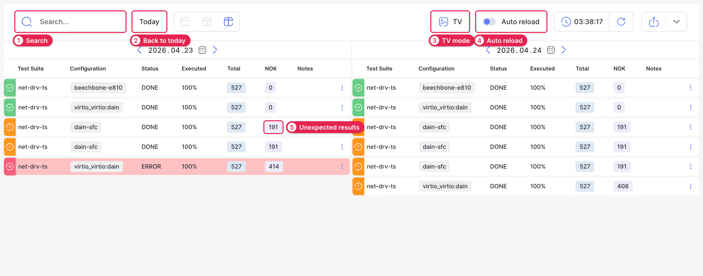

# Dashboard

The Dashboard answers one question: what ran recently, and how did it go? It lists the runs of a day with their status and failure counts, so you can spot the run that needs attention without opening each one.

Open it with **Dashboard** in the sidebar.

1. **Search.** Narrows the tables to rows that contain your text.
2. **Today.** Jumps back to the current day. To see another day, use the arrows or the calendar above each table. The buttons next to **Today** switch between three layouts: a single day in one column, a single day in two columns, or two days with a column each.
3. **TV.** Fills the screen with the tables, for a monitor on the wall. Press Esc to leave.
4. **Auto reload.** Reloads the page every 30 seconds, so you can follow runs that are still going.
5. **NOK.** The number of unexpected results in the run. Click it to open the run with its failures already expanded.

Which columns the tables have depends on the project's configuration. See [Dashboard Configuration](../03-configuration/02-project-config/index.md#dashboard-configuration).
