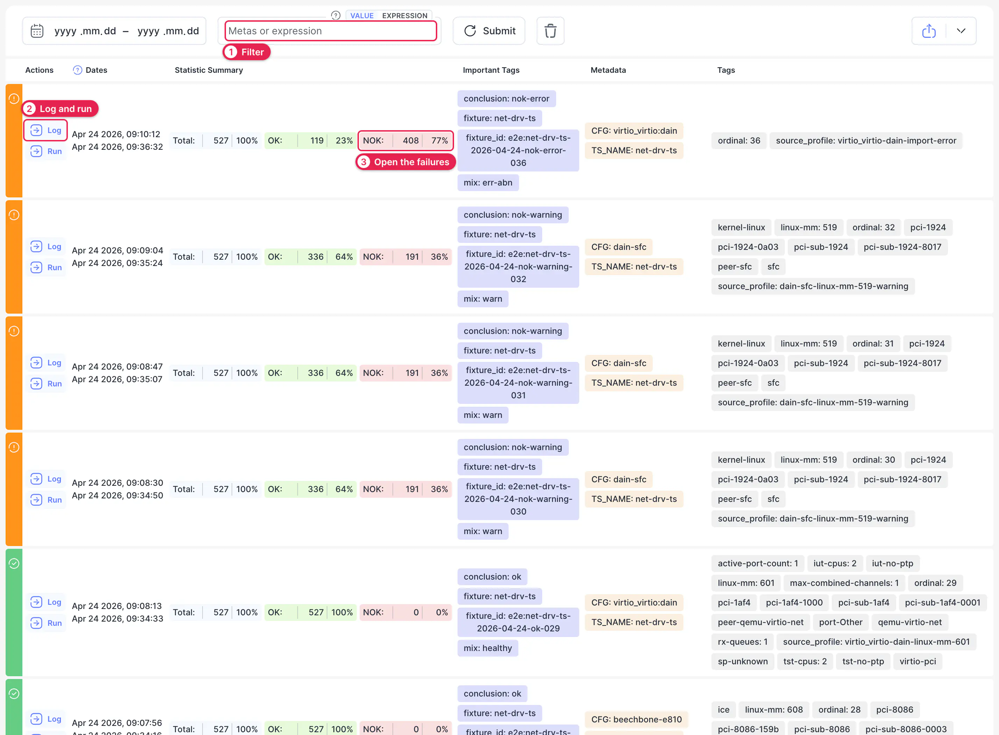
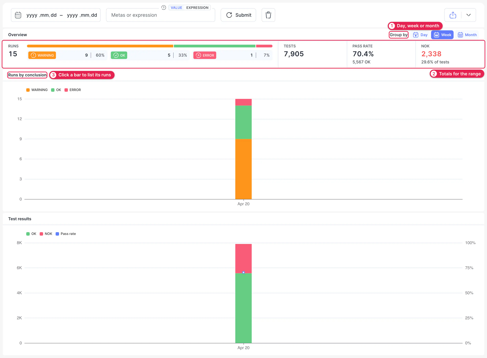
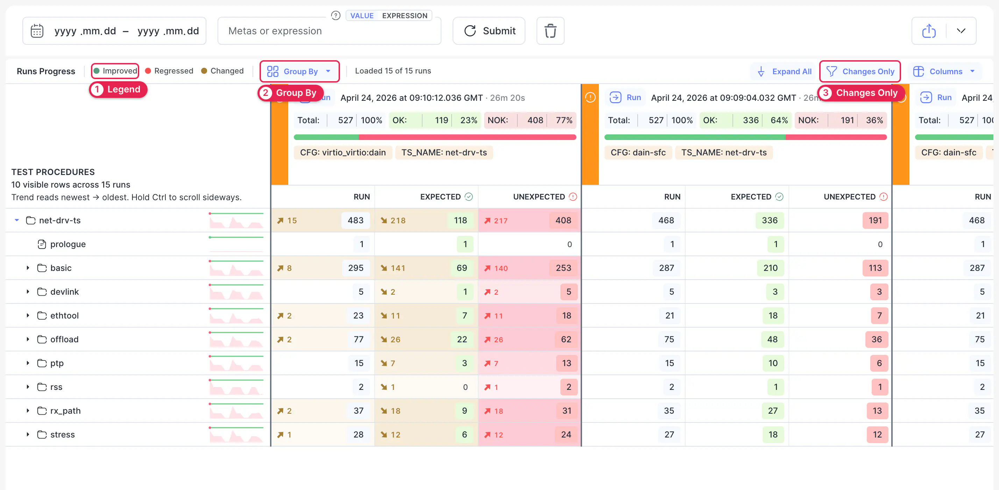
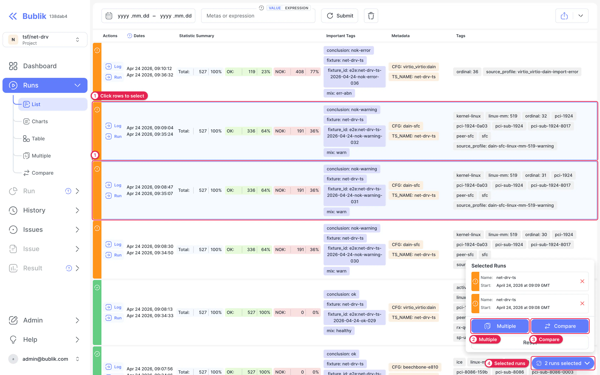
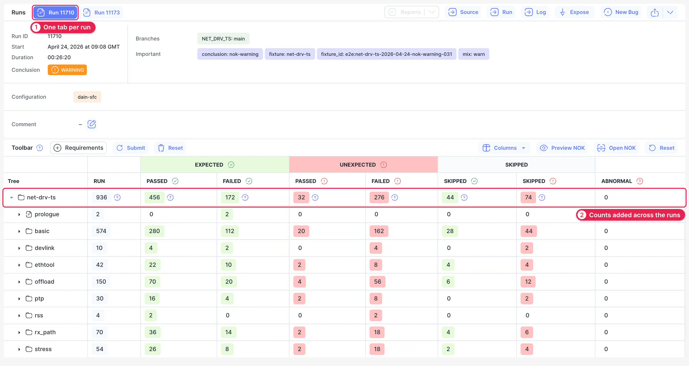
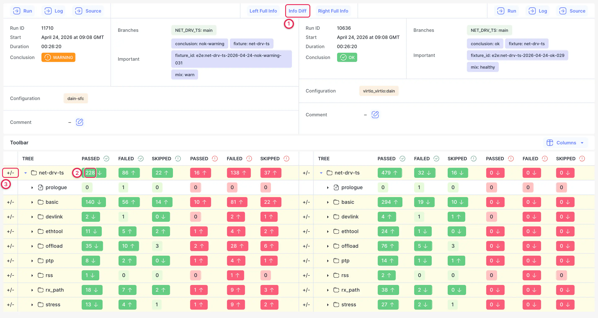

# Runs

Runs is the full record of what you've tested. Use it to find a particular run, see how results trend over time, and put runs side by side.

Open it with **Runs** in the sidebar. Its submenu has three views of the same runs (**List**, **Charts** and **Table**) and two pages for working with selected runs (**Multiple** and **Compare**).

## List {#list}

Use the list to find a run. Each row shows when the run started and finished, how many tests passed and failed, and its tags.

1. **Filter.** Type tags or metadata, or switch to **Expression** to combine them. Set dates with the range next to it, then click **Submit**.
2. **Log and Run.** Open the run's [log](./04-log.md) or its [Run](./03-run.md) page.
3. **NOK.** The count and share of unexpected results. Click it to open the run with its failures expanded. Hold Ctrl while you click to open the results as well.

The colored stripe on the left of each row is the run's conclusion. Hover over it to read the reason. Click a tag on any row to find the other runs that share it.

## Charts {#charts}

Use the charts to see a period at a glance: how many runs there were, how they ended, and whether the pass rate is moving.

1. **Group by.** Draws one bar per **Day**, **Week** or **Month**.
2. **Overview.** Totals for the selected range: runs by conclusion, tests, pass rate and NOK count.
3. **Runs by conclusion.** Click a bar to list the runs behind it. **Test results** below it adds the pass rate as a line.

## Table {#table}

Use the table to see how a suite changes from run to run. Each column is a run, newest first, and each row is a package or test. Instead of opening runs one by one, you read across a row.

1. **Legend.** An arrow in a cell shows how far its value moved between runs: **Improved**, **Regressed** or just **Changed**.
2. **Group By.** Groups the runs by a time frame, then by a metadata value.
3. **Changes Only.** Hides zero and unchanged values, leaving only the cells that moved.

The small chart next to each row is that row's trend across the loaded runs. Hold Ctrl and scroll to move sideways through the runs.

## Multiple Runs {#multiple}

Use this when you want several runs read as one, such as a test campaign split across several runs. The table adds the counts of all the selected runs together.

Start from the list and click the rows of the runs you want. The **Multiple** and **Compare** rows in the sidebar stay disabled until you've selected runs.

1. **Select rows** by clicking them. Click a row again to deselect it.
2. **Multiple** opens the selected runs together.
3. **Compare** opens two selected runs side by side. See [Compare Runs](#compare).
4. **The selection pill** stays at the bottom of the page and opens the list of selected runs.

1. **One tab per run.** Switches the details at the top between the runs.
2. **Combined counts.** The table works like the [Run table](./03-run.md#run-table), with each count added up across the runs.

## Compare Runs {#compare}

Use this to find what changed between two runs, for example between a passing build and a failing one. Select exactly two runs in the list and click **Compare**, or click **Compare** on a [Run](./03-run.md) page and enter the other run's ID or URL.

1. **Info Diff.** Shows only the details that differ, such as tags and configuration. **Left Full Info** and **Right Full Info** show one run in full.
2. **Arrows.** Each count shows whether it's higher or lower than in the other run.
3. **+/-.** Marks the rows whose counts differ, so you know which packages to open.
