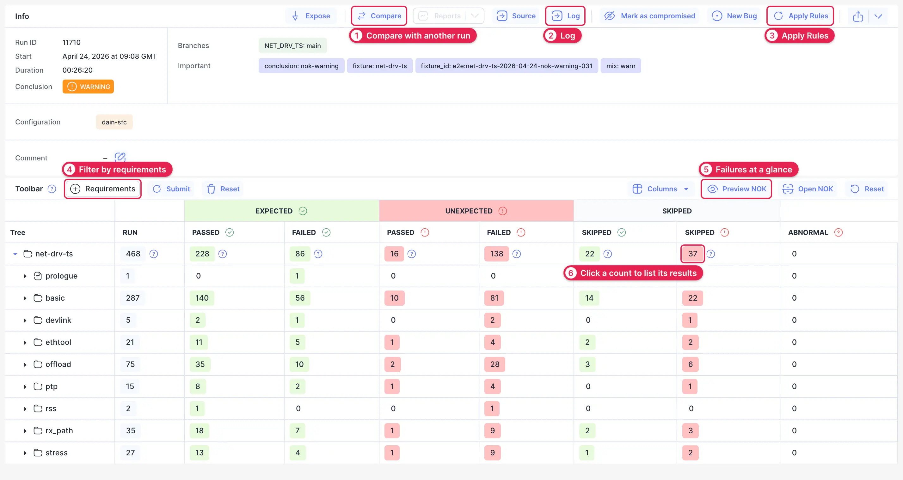
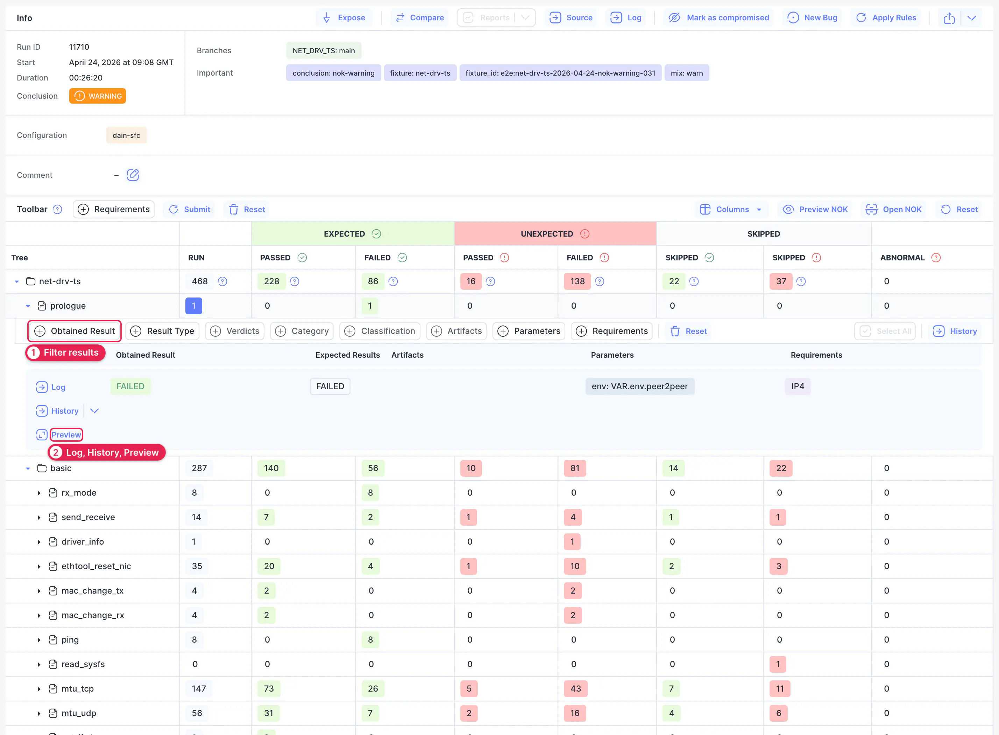
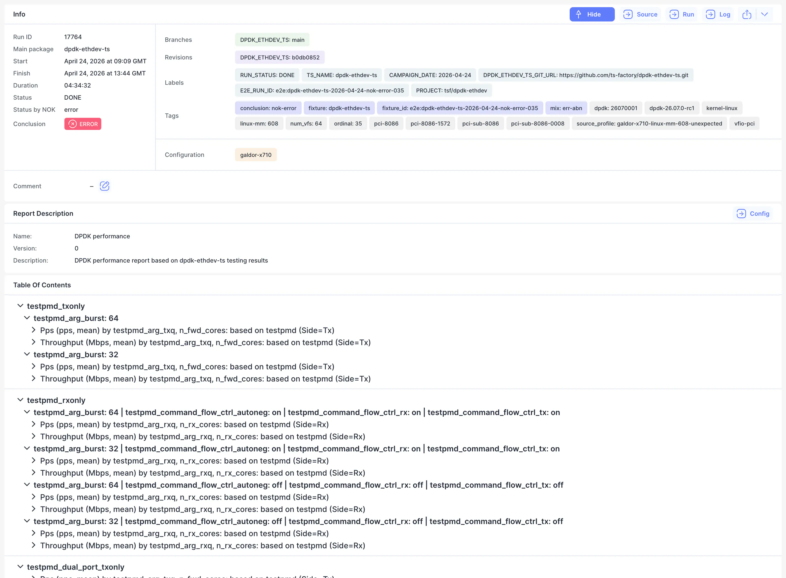
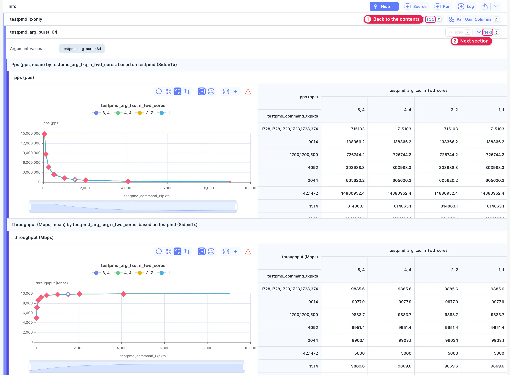
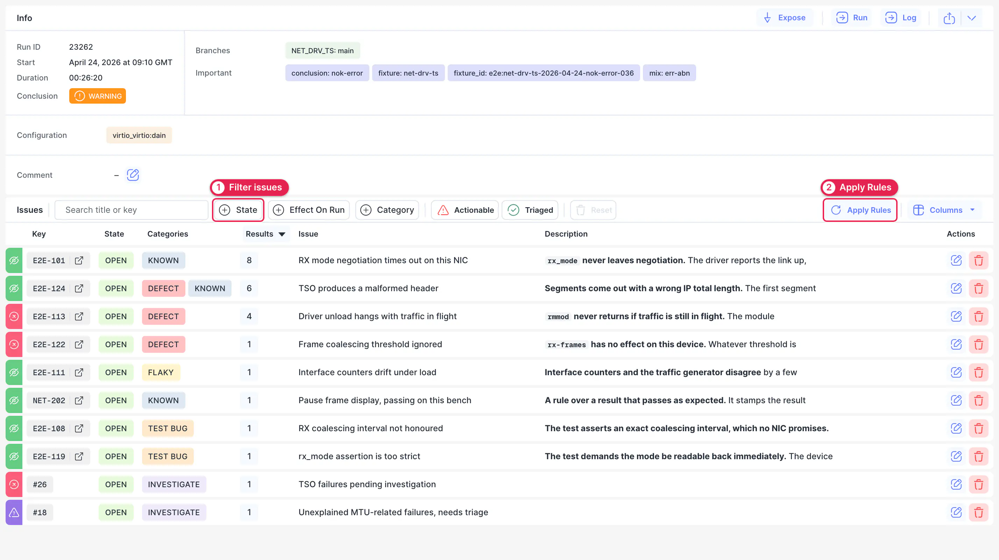

# Run

The Run page shows one run: what it was, which tests failed, and whether those failures were expected. This is where you start working out why a run went wrong.

Open a run from the [Runs](./02-runs.md) list or the [Dashboard](./01-dashboard.md). The **Run** row in the sidebar is disabled until you've opened one, and after that it takes you back to the last run you opened.

## Details {#details}

The top of the page says what the run was and how it ended. Below it is the [run table](#run-table).

1. **Compare.** Compare this run with another. See [Compare Runs](./02-runs.md#compare).
2. **Log.** Opens the run's [log](./04-log.md). **Source** opens the original logs the run was imported from.
3. **Apply Rules.** Runs all active rules against this run's results again. See [Issues](#issues).
4. **Requirements.** Limits the table to tests with the requirements you choose. Click **Submit** to apply them.
5. **Preview NOK.** Filters the table to unexpected results and opens the packages that have them. **Open NOK** also opens the results. **Reset** clears the table back to how it started.
6. **Counts.** Click a count to list the results behind it. See [Run Table](#run-table).

**Conclusion** sums up the run: for example, **WARNING** when some results were unexpected. **Mark as compromised** flags a run whose results shouldn't be trusted, and History can filter those runs out.

## Run Table {#run-table}

The table is a tree of the run's packages and tests, with result counts on every row. Results are split by whether they match what the test was **expected** to do. A test that fails as expected isn't a new problem, while an **unexpected** pass or failure is.

To find failures:

1. Click the arrow on a package to open it.
2. Click a count to filter the table and open the results behind it. Click more counts to combine them.
3. Click **Reset** at the right of the Toolbar to start over.

1. **Filter results** by obtained result, result type, verdicts, category, classification, artifacts, parameters and requirements.
2. **Links on each result.** **Log** opens the result's log. **Preview** opens it without leaving the table. **History** shows the same test in other runs, and its arrow chooses what to match: for example, the test path alone, or the path plus parameters and verdicts.

To explain a failure, click its row and classify it. See [Classify Results](./07-issues.md#classify).

## Report {#report}

A report turns a run's measurements into charts and tables, arranged by a [report config](../03-configuration/03-report-config/index.md). It's built for performance tests, where one number per result doesn't say much.

**Report** in the sidebar and **Reports** on the run page are disabled when no report config applies to the run. Otherwise, use the arrow next to **Reports** to pick a config.

The page starts with the run's details, the report's description and a table of contents. Click an entry to go to its section.

1. **TOC.** Returns to the table of contents. Press `t` to do the same.
2. **Next.** Moves to the next section. **Prev** moves back. Press `j` and `k`.

Each chart has the same controls as those on the [Result](./06-result.md#charts-tables) page.

## Issues {#issues}

Issues lists every classified failure in the run, and how many results each issue accounts for. Use it to answer: of everything that failed, what do we already understand, and what's still new?

The row is available only when at least one result in the run has a classification stamp. To get one, [classify](./07-issues.md#classify) a failing result, or click **Apply Rules** to stamp this run with the rules that are already active. Creating a rule doesn't classify existing runs on its own.

1. **Filters.** Narrow the list by state, effect on the run and category. **Actionable** and **Triaged** set the category filter in one click: Actionable covers defects, test bugs and failures to investigate, and Triaged covers environment, flaky and known issues.
2. **Apply Rules.** Runs all active rules against the run's results again. Use it after you add or edit rules. Inactive rules and the rules of closed issues are skipped.

The number next to each issue is how many of this run's results it stamped. To manage issues across all runs, see [Issues](./07-issues.md).
