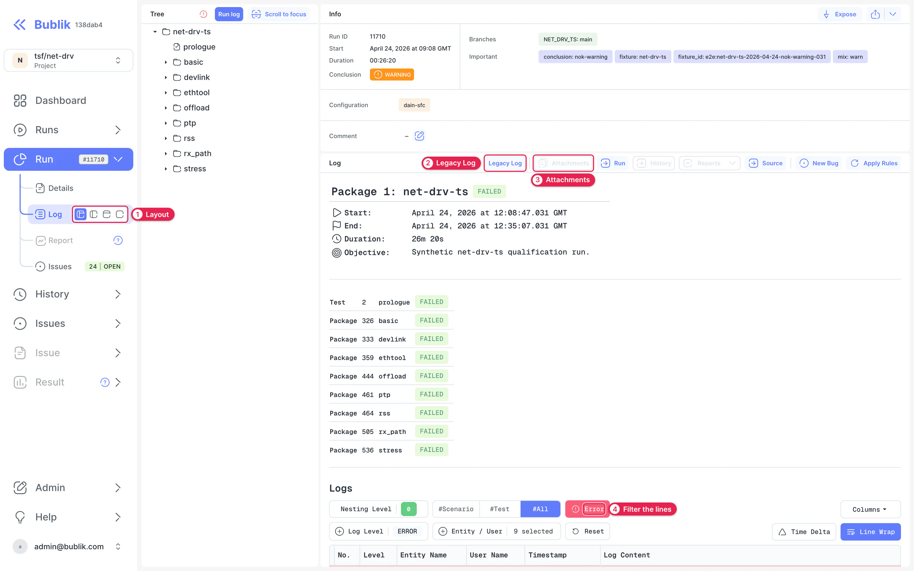

# Log

The Log page shows what actually happened during a run, package or test, down to each logged line. Come here once you know which test failed and need to know why.

Open it with **Log** on a [Run](./03-run.md) page, on a row of the [Runs](./02-runs.md) list, or on a single result. **Log** in the sidebar is disabled until you've opened a run.

## Layouts {#layouts}

1. **Layout.** The switch on the **Log** row of the sidebar chooses what appears beside the log: **Tree + info + log**, **Tree + log**, **Info + log** or just **Log**. The tree lets you move around the run, and the info panel shows the run's details.
2. **Legacy Log.** Switches to the log's original HTML pages. To make that your default, go to **Settings → Preferences**.
3. **Attachments.** Opens the files attached to what you're viewing. See [Artifacts](#artifacts).
4. **Filters.** **Nesting Level**, **#Scenario**, **#Test**, **#All** and **Error** decide which lines appear. **Log Level** and **Entity / User** narrow them further.

The top of the log says what you're looking at: the package or test, its result, its timing and its objective. For a package, a table lists what's inside it.

**Time Delta** shows the time between lines, which helps when you're looking for a stall. **Line Wrap** switches how long lines are shown, and **Columns** chooses which columns appear.

**Run**, **History**, **Reports** and **Source** take you to the related pages. **Apply Rules** applies the active rules, as on the [Run](./03-run.md#issues) page.

## Artifacts {#artifacts}

Tests can leave files behind, such as captures and dumps. **Attachments** lists them, and you can download each one. It's disabled when there's nothing attached.

To attach files to your logs, see [Attachments](../04-publish/01-attachments.md).

## Packet Viewer {#packet-viewer}

When a test leaves a packet capture, you don't need to download it to read it. Open it from **Attachments**, and Bublik shows it in the packet viewer in a new tab, with each packet's decoded fields and raw bytes.

The viewer opens only from a capture, so it has no row in the sidebar.
