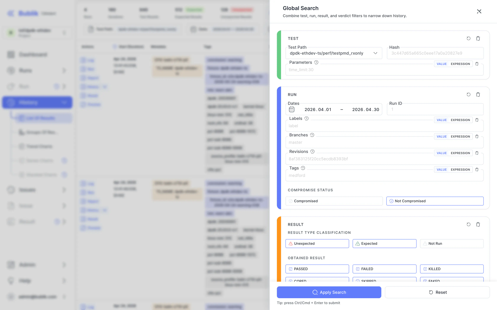
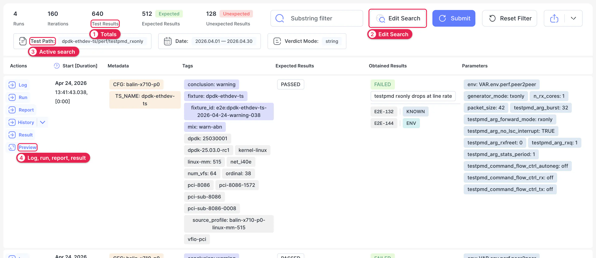
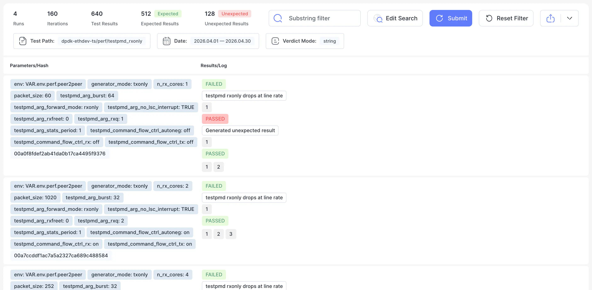
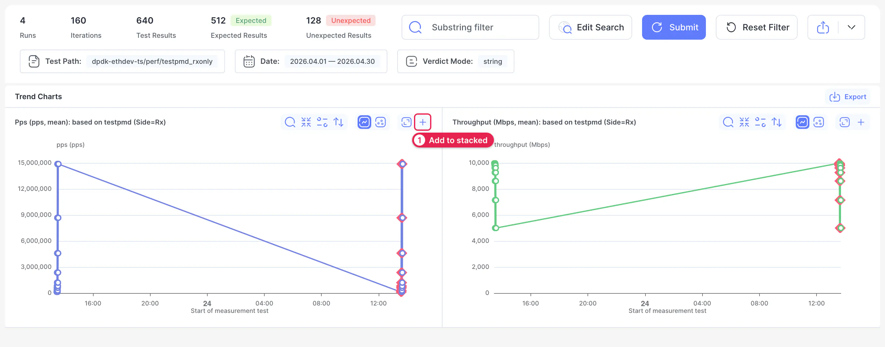
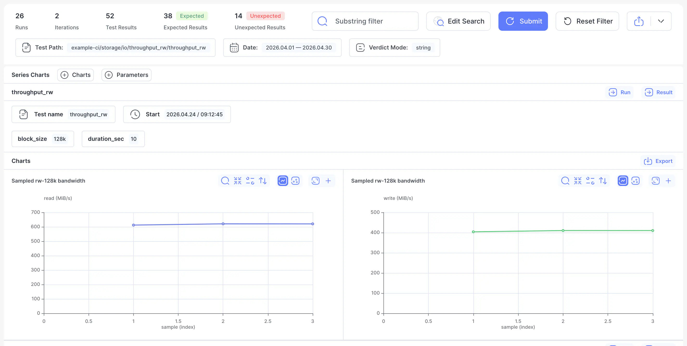
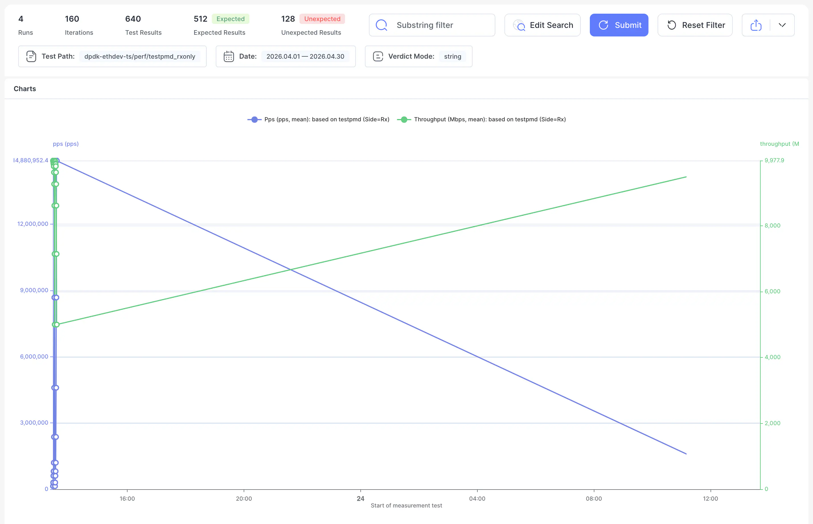

# History

History shows how one test behaved across runs. Use it to find out whether a failure is new, how often it happens, and which configurations it happens on.

There are two ways to get there:

- **History** on a result in the [Run table](./03-run.md#run-table). This is the most common way, because it carries the test over for you. Use the arrow next to it to choose what to match, such as **Test Path + Parameters**.
- **History** in the sidebar, then fill in the search yourself.

The sidebar row has five views of the same search. The chart views are disabled until you've run a search.

## Search {#search}

History needs a test to search for. Click **Edit Search** at the top of any view to open the search form.

The form has a section for each thing you can filter by:

- **Test.** The test path, hash and parameters.
- **Run.** Dates, run ID, labels, branches, revisions, tags and whether the run was compromised.
- **Result.** Whether the result was expected, and what it obtained.
- **Classification.** The issue, the triage state and the category.

Parameter, tag, label, branch and revision fields suggest values that exist in the project. Switch a field to **Expression** to combine values. Click **Apply Search**, or press Ctrl/Cmd + Enter.

The search is written to the URL, so you can share the page with someone else.

## List Of Results {#list}

The list shows every matching result. Read it when you care about individual results: when each one happened, on what, and what it obtained.

1. **Totals.** How many runs, iterations and results match, and how many were expected.
2. **Edit Search.** Opens the search form.
3. **Active search.** What's currently applied.
4. **Links on each result.** **Log**, **Run**, **Report**, **History**, **Result** and **Preview**.

To narrow the list down without opening the form, type in **Substring filter**, or click a tag, parameter or verdict on a result and select it from the menu. Then click **Submit** to apply it, or **Reset Filter** to go back.

## Groups Of Results {#groups}

Groups combines results that have the same parameters into one row. Use it to see which parameter combinations fail, without reading through every result.

Each row lists one combination of parameters with its hash, then the results and verdicts it obtained. The numbers under a result stand for the individual results behind it.

## Trend Charts {#trend-charts}

Trend charts plot a test's measurements over time, with one point per result. Use them to spot when performance changed. They only have something to show for tests that record measurements.

1. **+** adds a chart to the [stacked view](#stacked-charts).

A diamond marks a result with an error. Click a point to see the result behind it. The other chart controls are explained on the [Result](./06-result.md#charts-tables) page.

## Series Charts {#series-charts}

Series charts show the samples recorded during each result, rather than one value per result. Use them to compare how the same test behaved within different iterations.

**Charts** and **Parameters** at the top narrow the page to the charts and iterations you want. **Run** and **Result** open the run or result behind each group.

Series charts need tests that record a series of samples. A test that records only one value per result, such as a mean, shows **No results** here. Look at its [Trend Charts](#trend-charts) instead.

## Stacked Charts {#stacked-charts}

Stacked charts draw several measurements on one chart, so you can see whether they move together. This row is disabled until you've chosen some charts.

1. Open [Trend Charts](#trend-charts) or [Series Charts](#series-charts).
2. Click **+** on each chart you want to combine.
3. Click **Stacked** in the pill at the bottom of the page, or **Stacked Charts** in the sidebar.

Each measurement has its own axis and color. To change what's on the chart, go back and use the pill to remove charts or reset the selection.
