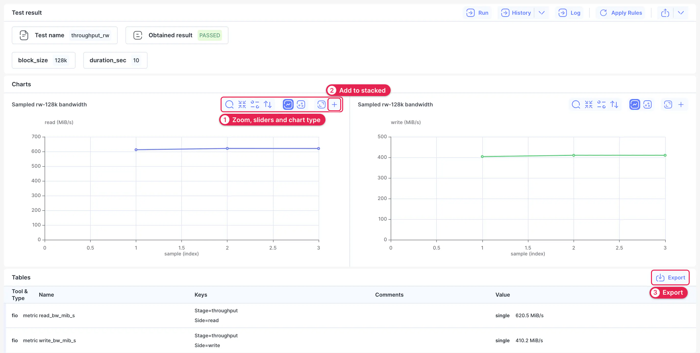
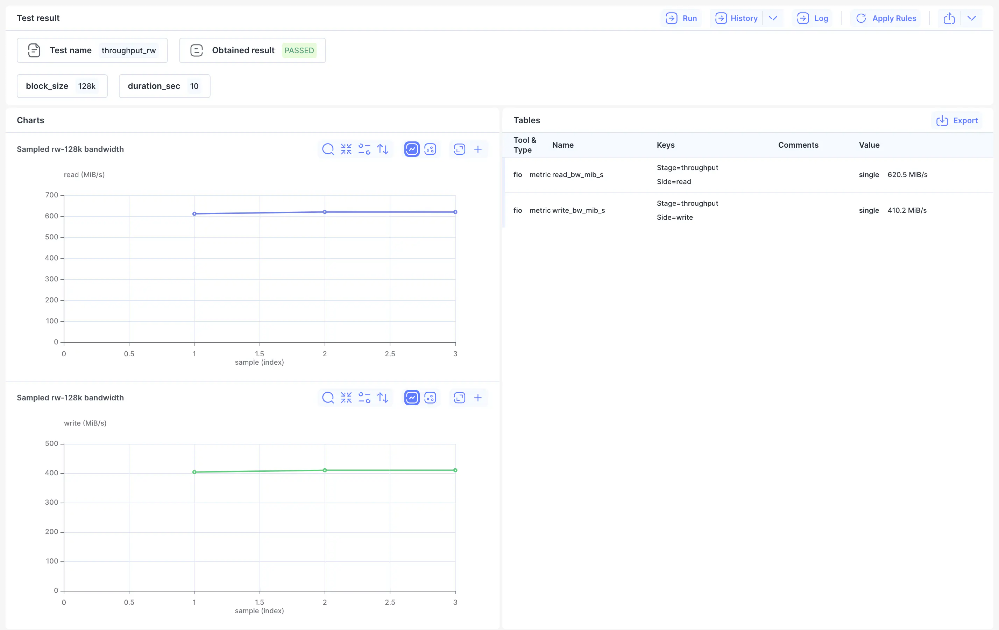
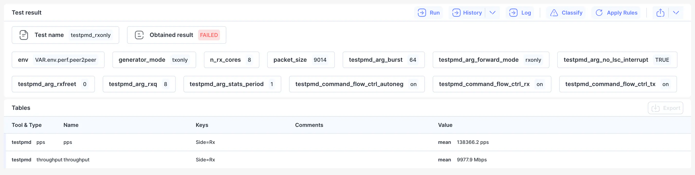

# Result

The Result page shows the measurements recorded by one test result, such as throughput or packets per second, as charts and tables. Use it when a test's pass or fail doesn't tell the whole story.

Open it with **Result** on a [History](./05-history.md#list) row, or from a result's [Run](./03-run.md#run-table) or [Log](./04-log.md) page. The **Result** row in the sidebar is disabled until you've opened one.

The submenu has four layouts of the same data. Pick the one that suits what you're reading.

## Charts + Tables {#charts-tables}

The default layout has the charts on top and the table underneath.

1. **Chart controls.** From left to right: enable zoom, reset zoom, show sliders, limit the y-axis to the data, switch between a line and a scatter chart, and open the chart full screen. Hover over a button to see its name.
2. **+** adds the chart to [Stacked Charts](#stacked).
3. **Export** exports the table.

The header above the charts shows the test, what it obtained and its parameters. **Run**, **History** and **Log** take you to the related pages, and **Apply Rules** applies the active rules.

## Charts || Tables {#split}

This layout puts the charts and table side by side, so you can read values against a chart without scrolling. It works best on a wide screen.

## Measurement Tables {#tables}

This layout shows only the table. Use it when you want exact values, or for tests that record single values and have no charts.

Each row is one measurement: the tool that took it, its name and keys, and its value.

## Stacked Charts {#stacked}

Stacked Charts draws the charts you've chosen on one chart, so you can compare them. The row is disabled until you've chosen some.

1. Open [Charts + Tables](#charts-tables).
2. Click **+** on each chart you want to combine.
3. Click **Stacked Charts** in the sidebar.

It works the same way as [Stacked Charts in History](./05-history.md#stacked-charts), which shows an example.
