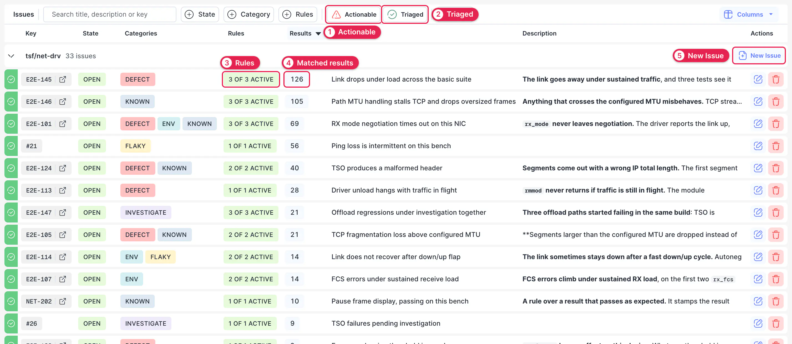
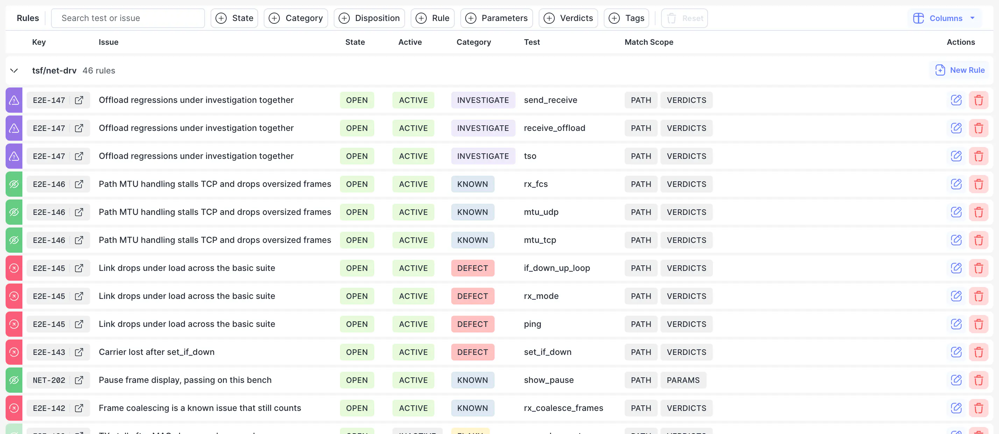
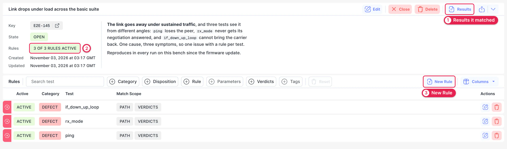

# Issues

A run often fails in ways the team already knows about, such as a known product bug or a flaky test. Issues let you explain a failure once, so later runs don't report it as new.

Three terms are worth knowing:

- **Issue.** The reason results failed, such as a bug, a flaky test or an environment problem. It can link to your bug tracker.
- **Rule.** The results of one test that belong to the issue. A rule matches the test path and, optionally, parameters, verdicts and tags.
- **Stamp.** The mark a rule leaves on a matching result. Stamps are added when a run is imported, when you classify a result, and when you click **Apply Rules**.

Each rule has a category, and the category sets the default **disposition**, which decides whether the stamped results still count:

| Category             | Badge       | Default disposition |
| -------------------- | ----------- | ------------------- |
| Product defect       | DEFECT      | Unexpected          |
| Test/automation bug  | TEST BUG    | Expected            |
| Environment / infra  | ENV         | Expected            |
| Known issue          | KNOWN       | Expected            |
| Flaky / intermittent | FLAKY       | Expected            |
| To investigate       | INVESTIGATE | Marked              |

Open these pages with **Issues** in the sidebar. To see the issues of a single run, go to [Run → Issues](./03-run.md#issues).

:::info
Viewing issues is public. Classifying results, applying rules and editing issues and rules require sign-in, unless your project allows them without it. To allow that, add `manage_issues` to the project's `NOT_PERMISSION_REQUIRED_ACTIONS`.
:::

## Classify Results {#classify}

Classify a failure from the [Run table](./03-run.md#run-table):

1. Open a test's results, and click the rows that failed for the same reason. You can select rows of other tests too.
2. Click **Classify** to open the drawer.
3. Under **Issue**, record a new issue, or pick an existing one. Pasting a full reference into **Bug Key** fills in the tracker and the key.
4. Under **Classification**, choose one or more categories. The disposition follows the category, and you can override it. Each category creates its own rule.
5. Under **Apply to**, choose **This + future matching runs** to create rules, or **Just this result** to stamp only the selected results.
6. For future runs, set **Match Scope**. The path is always matched. Parameters, verdicts and tags are filled in from the selected results; remove values to make the rule broader, or clear a field to stop matching on it.

A new rule stamps only the results you selected. To stamp the other matching results in the run, click **Apply Rules** on the run page.

## Issues {#issues}

This page lists issues, grouped by project and sorted by how many results each one has stamped. The sidebar badge shows how many are open.

1. **Actionable.** Shows what still needs work: failures to investigate, product defects and test bugs.
2. **Triaged.** Shows what's already explained: environment, flaky and known issues.
3. **Rules.** The number of active rules out of the total. An issue can also show **No rules**, **No active rules** or **Deactivated**.
4. **Results.** How many results the issue has stamped, across all runs.
5. **New Issue.** Records an issue before anything fails, such as a bug you already know about.

Search, **State**, **Category**, **Rules** and the sort order are kept in the URL, so you can share a filtered list. An issue without a tracker key shows its ID instead, such as `#21`.

## Rules {#rules}

This page lists the rules themselves. Use it when you're starting from a test rather than an issue, and want to know what's matching it.

**Match Scope** shows what each rule matches on. To change a rule's disposition or scope, or to deactivate it, use the edit button on its row. Filter the list by state, category, disposition, rule, parameters, verdicts or tags.

## Issue {#issue}

Click an issue in the list to open its page. **Issue** in the sidebar is disabled until you've opened one, and its submenu has the issue's **Results** and **Rules**.

1. **Results.** Lists every result the issue stamped, across all runs, with links to the run, log and history.
2. **Rules.** How many of the issue's rules are active.
3. **New Rule.** Adds a rule to this issue without classifying a result first.

**Close** closes the issue and deactivates its rules, so the results they suppressed count as unexpected again. Reopening an issue doesn't reactivate its rules, so you need to turn them back on one by one.

To follow an issue over time, use the **Classification** section of the [History search](./05-history.md#search).
