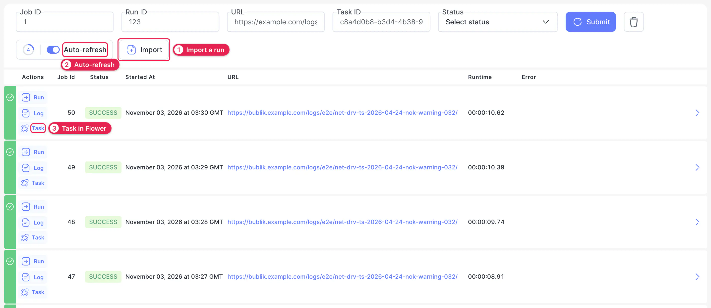
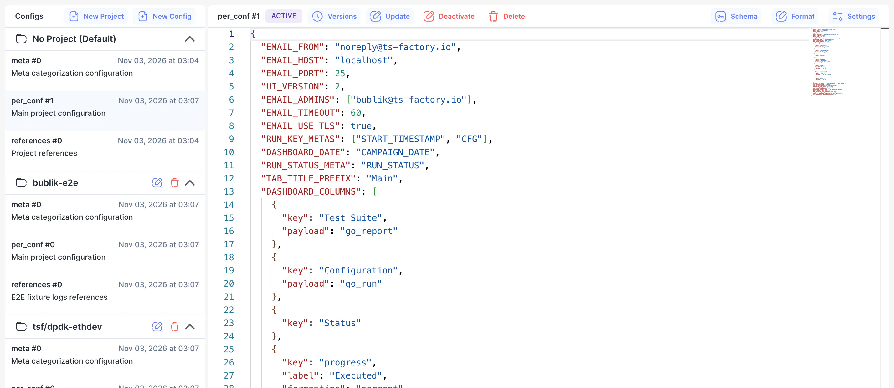
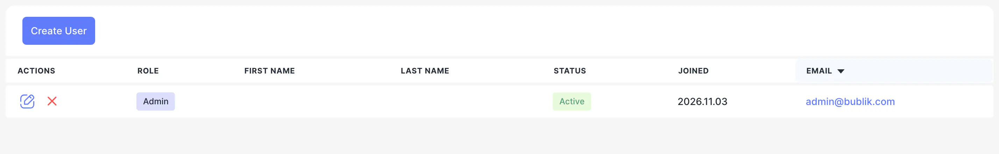

# Admin

Admin pages are for the people who run a Bublik instance: getting runs in, configuring projects and managing accounts.

Open them with **Admin** in the sidebar.

## Import {#import}

Import brings a run's logs into Bublik and shows how each import went. Use it to import a run by hand, or to find out why one failed.

1. **Import.** Opens the import form. Give it the URL of a run's logs and, optionally, a project and a date range. **Force Import** imports a run again.
2. **Auto-refresh.** Keeps the list up to date while imports run.
3. **Task.** Opens the import's task in [Flower](#flower). **Log** shows the import's own log, and **Run** opens the imported run.

Filter the list by job ID, run ID, URL, task ID or status.

To set up automatic imports, see [Publish](../04-publish/index.md).

## Configs {#configs}

Configs is where you edit the settings of Bublik and its projects. Each project has its own configs, and **No Project (Default)** holds the shared ones.

Click a config to open it in the editor. **Schema** shows which fields it accepts, and **Format** tidies its JSON. The number after a config's name is its version: **Update** saves your changes, and **Versions** lists the config's versions. **New Project** and **New Config** are at the top of the list.

For what each config does, see [Configuration](../03-configuration/index.md).

## Users {#users}

Users lists every account on the instance. **Create User** adds one, and the buttons on each row edit or remove it.

## Flower {#flower}

Flower is the dashboard of the task queue that runs imports. Use it when imports seem stuck, to see which tasks are queued or running.

## Analytics {#analytics}

Analytics shows which pages people visit and which actions they use most. It's off by default, and the row appears only for admins, once it's turned on. See [Analytics](../03-configuration/05-analytics.md).
