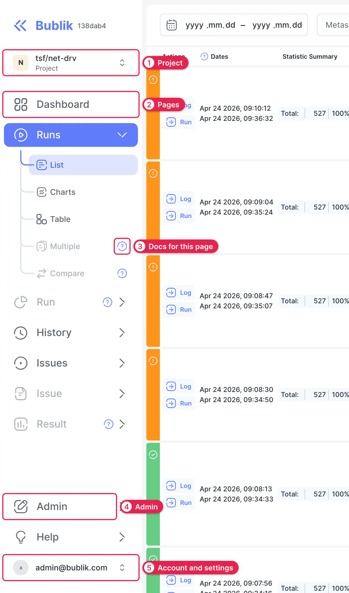
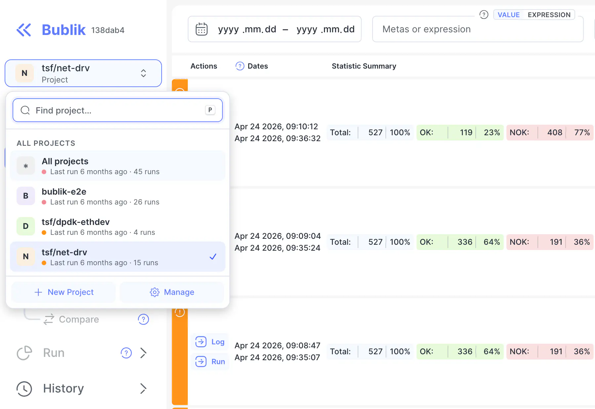

# User Guide

Bublik collects your test runs and helps you find out what failed, whether it failed before, and whether anyone has already explained it. This guide says what each page is for and how to use it.

A typical investigation moves through the pages in this order:

1. The [Dashboard](./01-dashboard.md) or the [Runs](./02-runs.md) list shows which run needs attention.
2. The [Run](./03-run.md) page shows which tests failed in it.
3. The [Log](./04-log.md) shows why a test failed.
4. [History](./05-history.md) shows whether the test failed before, and on which configurations.
5. The [Result](./06-result.md) page shows the measurements, when the test records any.
6. [Issues](./07-issues.md) records the explanation, so the next run doesn't report the same failure as new.

The other pages are [Chat](./08-chat.md), which answers questions about your runs, and [Admin](./09-admin.md), where runs get imported and instances get configured.

## Getting Around {#getting-around}

Every page is in the sidebar.

1. **Project.** Chooses the project whose data you see. See [Projects](#projects).
2. **Pages.** Click a row to open the page. Click its arrow to open the submenu, which lists the page's views.
3. **Docs for this page.** The question mark opens the matching section of this guide in a new tab. It shows when you hover over a row, and it's always visible on a disabled row.
4. **Admin.** Pages for importing runs, editing configs and managing users.
5. **Account and settings.** Opens your [settings](#settings).

**Run**, **Issue** and **Result** start out disabled, because each one shows a single item. They become available once you open a run, an issue or a result, and they take you back to the last one you opened. Other rows depend on what you've done:

- **Multiple** and **Compare** need [selected runs](./02-runs.md#multiple).
- **Trend Charts**, **Series Charts** and **Stacked Charts** need a [History search](./05-history.md#search).
- **Run → Issues** needs at least one [classified result](./03-run.md#issues) in the run.

## Projects {#projects}

A project groups the runs of one test suite, with its own configs, issues and rules. Pick a project, and the pages show that project's data.

The selected project is part of the page URL, so a link you share opens the same project for whoever follows it.

## Settings {#settings}

Click your account at the bottom of the sidebar to open **Settings**. It has four tabs:

- **Account.** Your name and password.
- **Appearance.** Light, dark, or the same as your system.
- **Preferences.** Whether logs open in the legacy view, and which view History opens in.
- **Beta.** Features that are still being tried out.

**Sign Out** is in the same window.
